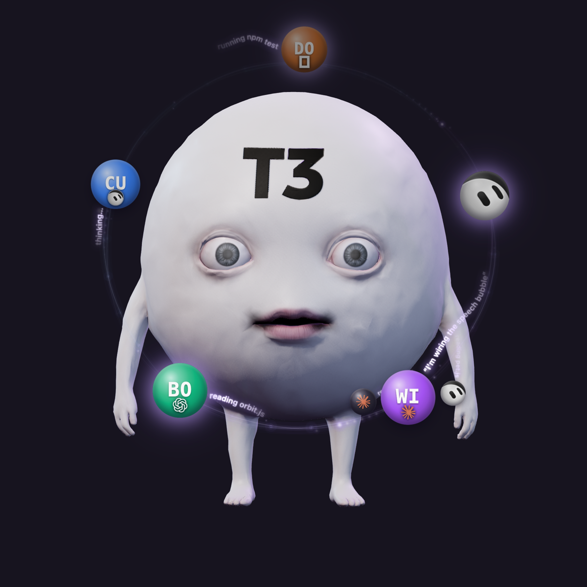

# t3buddy

<p align="center"></p>

The app itself is called Local Model Widget; T3boii is its desk pet.

A desktop heads-up display for macOS that works as a companion app to T3 Code. It connects to the T3 Code server you already run on your Mac through T3 Code's MCP server, and shows your agents live on the desktop: every active thread and subagent, what each one is doing, which ones are waiting on you, and which ones failed. Alongside that it shows your local models, subscription usage, memory pressure and token use as a set of small desktop cards.

It is for anyone who runs a T3 Code server on their Mac and can let a local app connect to T3 Code's MCP server.

Repository: [github.com/josikinzz/t3buddy](https://github.com/josikinzz/t3buddy)

## What it shows

Everything lives in one transparent window pinned to the desktop (below normal windows, visible on every Space) plus a free-floating desk pet. Each card has a gear menu holding its secondary controls, including Desktop/Float mode (shared by all cards). Drag a card onto another to swap their places; the order is remembered.

**T3boii (desk pet)**
- Each active T3 Code thread is an orb on a halo around him, showing the project's icon and the provider's logo (Claude, Codex, Cursor, Grok, Kimi, OpenCode, Pi, Antigravity, or a generic mark).
- Subagents circle their parent thread as smaller satellite orbs. This covers both threads delegated through T3 Code and subagents a provider spawns itself (for example Claude's Agent tool).
- A short line about what each thread is doing ("reading pet.js", "running swift build", "thinking…") trails behind its orb.
- A thread waiting on you (a pending question or approval) is held out in front of him, pulsing amber. Clicking it opens that thread in T3 Code's web UI.
- A failed thread's orb cracks and turns red and stays until you hover or click it, for up to ten minutes.
- If the Grok Bot app is installed, its in-flight agents appear as orbs too.
- He can be petted, dragged and shaken, falls asleep when nothing is running, and honours Reduce Motion. See DESIGN.md for the full behaviour.
- Playing with him makes quiet, deep, non-verbal sound effects (soft low hums, thuds and whooshes with reverb; no voice, nothing shrill), generated with ElevenLabs and bundled in `Resources/Pet/sfx/`. Turn them off with **T3boii sounds** in the Subscription Usage card's gear menu.

**Cards**
- **Local Models:** the model currently loaded on Bonsai (`http://127.0.0.1:8080`), Magnitude (`http://127.0.0.1:10100` and the `magnitude` CLI) or Ollama (`http://127.0.0.1:11434`), with an Unload button. A host that is not running is skipped. The gear menu also opens a bundled model benchmark document (`Resources/ModelBenchmarks.*`).
- **Subscription Usage:** plan, 5-hour, weekly and monthly quota use for Claude, Codex and Kimi accounts it finds on the Mac (CLI Proxy accounts in `~/.cli-proxy-api`, `~/.codex*/auth.json`, `~/.kimi-code/credentials`). It calls the providers' read-only usage endpoints every five minutes and caches only the results. Account emails are pixelated until clicked. This card's gear menu also holds **Connect T3** and the idle-hide setting.
- **Process Memory:** unified memory use (Activity Monitor style) and the heaviest processes, each with a Force Quit button.
- **Tokens:** today's token total and a 7-day per-provider graph, read from local Claude Code (`~/.claude*`, `CLAUDE_CONFIG_DIR`), Codex (`~/.codex*`, `CODEX_HOME`) and Kimi (`~/.kimi-code`, `~/.kimi`) session logs.

**Idle hide:** after the Mac has had no keyboard or mouse input for a chosen number of minutes (default 10; set it in the Subscription Usage card's gear menu, where Never turns it off), it hides other apps so the desktop reads as a dashboard. It skips this while another app holds the display awake (a video call or a playing video, for example).

## Requirements

- macOS 14 (Sonoma) or later (`Package.swift` sets `.macOS(.v14)`).
- A Swift 5.9 or newer toolchain (`swift-tools-version: 5.9`), so Xcode 15 or newer, or the matching Command Line Tools. Built and checked here with Swift 6.3.
- For the T3 Code integration:
  - A T3 Code server running on the same Mac and listening on `http://127.0.0.1:3773`. The address is fixed in source (`T3ThreadSource.defaultOrigin`); there is no setting or environment variable for it.
  - T3 Code's runtime installed under `~/.t3/runtime`, so the app can find the `t3` CLI (see below). It does not look for `t3` on `PATH`.
- Optional, for the other cards: Bonsai, Magnitude or Ollama; CLI Proxy, Codex or Kimi sign-ins.

## Build and run

From the repository root:

```bash
swift build                                                # debug build
swift run LocalModelWidget                                 # run unpackaged, for quick checks
swift run --scratch-path .build-dev ModelWidgetChecks      # the check suite (an executable, not XCTest)
```

To build a signed (ad-hoc) app bundle and run it:

```bash
scripts/check_widget.sh      # lint the generated plists, run the checks, build
scripts/package_app.sh       # release build into "outputs/Local Model Widget.app"
scripts/run_widget.sh        # package if needed, then open the app
```

To start it at login with a LaunchAgent (label `local.codex.LocalModelWidget`, logs in `/tmp/local-model-widget.out.log` and `/tmp/local-model-widget.err.log`):

```bash
scripts/install_launch_agent.sh
scripts/uninstall_launch_agent.sh
```

`scripts/deployment.sh paths|check|info-plist|launch-agent-plist` prints or lints the generated paths and plists without installing anything. The scripts build into `.build-20261013/` and write to `outputs/`; both are git-ignored.

Prefer the packaged app for real use; the LaunchAgent points at it. The app has no Dock icon (it is an accessory app); quit it from the Local Models, Process Memory or Tokens gear menu.

### Demo mode

With the app running, `scripts/demo.sh` plays T3boii's scripted demo (about 43 seconds, for screen recordings): asleep with Zs and drool, woken with a stretch, threads glowing out of his forehead with subagents and activity trails, a few swallowed, one waiting on you, one failing, a build to 20+ threads (white eyes, light from his mouth), then swallowed back in waves and his all-done dance. It uses your real projects (T3 Code's projects and the git folders in `~/Projects`, with the same icons live threads get). Petting and shaking are left out: do those by hand afterwards. Run the script again to restart it; afterwards his orbit returns to your real threads. The script posts a Darwin notification (`notifyutil -p local.codex.LocalModelWidget.demo`); nothing listens on the network. With Reduce Motion on, the effects it shows are toned down as usual.

## How the T3 Code connection works

The app talks to T3 Code's MCP server over Streamable HTTP at `POST http://127.0.0.1:3773/mcp` with a bearer token, using only read tools: `orchestrator_capabilities`, `t3_environment_read`, `t3_project_list`, `t3_thread_list` and `t3_thread_read`. It polls every five seconds.

It gets its token without a browser, through T3 Code's MCP OAuth endpoints (authorization code with PKCE):

1. Registers an OAuth client once (`POST /oauth/mcp/register`, name "T3boii desktop widget") and keeps its id.
2. Mints a two-minute, `orchestration:read` pairing code with the T3 CLI: `t3 auth pairing create --scope orchestration:read --ttl 2m --label "T3boii desktop widget" --json`.
3. Approves the request with that code as `read-only` access (`POST /oauth/mcp/decision`) and exchanges the result for a token (`POST /oauth/mcp/token`).

The token, client id and any replaced sessions are stored in `~/Library/Application Support/LocalModelWidget/t3-mcp-token.json` (folder 0700, file 0600). When a token is replaced, the old T3 auth session is ended with `t3 auth session revoke <id>`. A token is treated as expired five minutes before its expiry time, and a new one is minted.

The `t3` CLI is found from `~/.t3/runtime/service-state.json` (`activeVersion` → `~/.t3/runtime/versions/<version>/t3`), falling back to the newest executable under `~/.t3/runtime/versions/`.

If no usable token exists, the app tries to connect on its own, at most once every 15 minutes (immediately again if T3 Code was simply not reachable). **Connect T3** in the Subscription Usage card's gear menu forces a fresh connection right away.

Clicking an orb opens `http://127.0.0.1:3773/<environmentId>/<threadId>`; the app only opens links to `127.0.0.1`, `localhost` or `::1`.

Problems never show in the UI: the orbit just stays empty, and the app logs one line per new kind of problem (prefix `T3boii:`) through `NSLog`.

## If you are an agent setting this up for someone

Follow these steps in order. Everything here comes from the source; nothing else needs configuring.

**What must already be true**

1. The person's Mac runs macOS 14 or later and has Xcode 15+ or Command Line Tools with Swift 5.9+ (`swift --version`).
2. T3 Code is installed through its normal runtime, so these exist:
   - `~/.t3/runtime/service-state.json` with an `activeVersion`, or at least one version folder in `~/.t3/runtime/versions/`;
   - an executable `~/.t3/runtime/versions/<version>/t3`.
3. The T3 Code server is running and answers on `http://127.0.0.1:3773`. The app cannot be pointed at another host or port without editing `T3ThreadSource.defaultOrigin`.
4. The person's T3 Code server has its MCP endpoint and MCP OAuth endpoints (`/mcp`, `/oauth/mcp/*`) available, and its `t3 auth pairing create` accepts `--scope orchestration:read`.

**Check the prerequisites**

```bash
cat ~/.t3/runtime/service-state.json                       # note activeVersion
ls ~/.t3/runtime/versions/                                 # the t3 binary lives in <version>/t3
T3="$HOME/.t3/runtime/versions/<activeVersion>/t3"
"$T3" auth pairing create --help                           # must list --scope, --ttl, --label, --json
curl -s -o /dev/null -w '%{http_code}\n' -X POST http://127.0.0.1:3773/mcp
```

The last command should print `401` (the server is up and wants a token). `000` means nothing is listening on that port: start T3 Code first.

**Build, install and connect**

1. From the repository root, run `scripts/check_widget.sh`. It must end with `All checks passed.` and a successful build.
2. Run `scripts/run_widget.sh` to try it, or `scripts/install_launch_agent.sh` to also start it at login.
3. The app connects by itself on its first poll. If it was started before T3 Code, either wait (it retries on the next poll when T3 Code was unreachable) or choose **Connect T3** from the Subscription Usage card's gear menu.

**Verify the connection**

- `~/Library/Application Support/LocalModelWidget/t3-mcp-token.json` exists and contains a `token`.
- The log has `T3boii: connected to T3's MCP server (read-only token, …)`. With the LaunchAgent this is in `/tmp/local-model-widget.err.log`; otherwise use `log show --last 10m --predicate 'process == "LocalModelWidget"' | grep T3boii`.
- `t3 auth session list` shows a session for the widget.
- Start any thread in T3 Code: an orb appears around T3boii within a few seconds and disappears after the thread finishes.

**Common failures** (as logged with the `T3boii:` prefix)

| Log line | Cause | Fix |
|---|---|---|
| `T3 not reachable (…); orbit empty` | Nothing answers on `127.0.0.1:3773`, or a request took longer than 6 s. | Start the T3 Code server; check the port with the `curl` above. |
| `T3 MCP connect failed (noCLI)` | No executable `t3` under `~/.t3/runtime/versions/`. | Install T3 Code's runtime; check `service-state.json` names a version that exists. |
| `T3 MCP connect failed (pairingFailed(…))` | `t3 auth pairing create` failed or printed no `credential`. | Run the pairing command from step 2 of "How the T3 Code connection works" by hand and read its error. If T3 Code keeps its data somewhere other than its default (for example `T3CODE_HOME` or `--base-dir`), note that the app runs the CLI without either. |
| `T3 MCP connect failed (cliTimedOut)` | The CLI took more than 15 s. | Check the CLI runs promptly by hand. |
| `T3 MCP connect failed (http("/oauth/mcp/…", …))` | The OAuth step was refused. A 4xx on `/oauth/mcp/decision` with a stored client id makes the app register a new client on its own. | Check the T3 Code version supports MCP OAuth with pairing codes. |
| `T3 rejected the MCP token; reconnecting on a later poll` | The token was revoked or expired early. | Nothing; it reconnects. Use **Connect T3** to do it now. |
| `T3boii: could not write the T3 token file (…)` | `~/Library/Application Support/LocalModelWidget` is not writable. | Fix the folder's ownership or permissions. |

After a failed automatic connect the app waits up to 15 minutes before trying again (unless T3 Code was simply unreachable). Use **Connect T3** instead of waiting.

## Project layout

```
Package.swift
Sources/
  ModelWidgetCore/        data sources and pure logic: T3 MCP client and OAuth, thread → orb mapping,
                          Grok Bot roster, model hosts, subscription and token usage, processes
  LocalModelWidgetPanel/  layout and presentation logic shared by the cards (masonry grid, palettes)
  LocalModelWidget/       the AppKit/SwiftUI app: dashboard window, cards, pet window, runtimes
Tests/ModelWidgetChecks/  check suite, run as an executable (swift run ModelWidgetChecks)
Resources/
  Pet/                    T3boii's WKWebView page (three.js, vendored under Pet/vendor), model and badges
  ModelBenchmarks.*       the benchmark document the Local Models card opens
scripts/                  package, run and LaunchAgent scripts (deployment.sh holds the shared settings)
DESIGN.md                 visual and behaviour spec, including the pet
PRODUCT.md                who it is for and what each part does
```

## Licence

The code is MIT licensed (see [LICENSE](LICENSE)). Third-party assets keep their own terms and are not covered by it:

- three.js, vendored under `Resources/Pet/vendor/three`, is MIT licensed (its own `LICENSE` is alongside it).
- The T3boii 3D model (`Resources/Pet/T3-rigged.glb`) comes from the T3 community dance page (t3-dance-sand.vercel.app).
- Provider logos under `Resources/Pet/badges` (Claude, Codex, Grok Bot and others) belong to their owners and are used only to identify each provider.
- The sound effects under `Resources/Pet/sfx` were generated with ElevenLabs.
